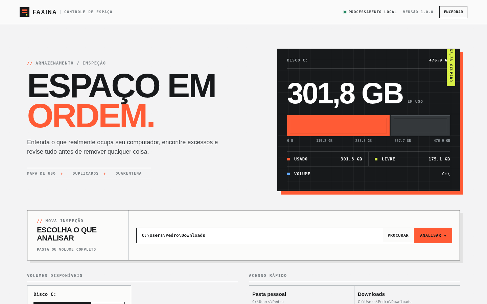
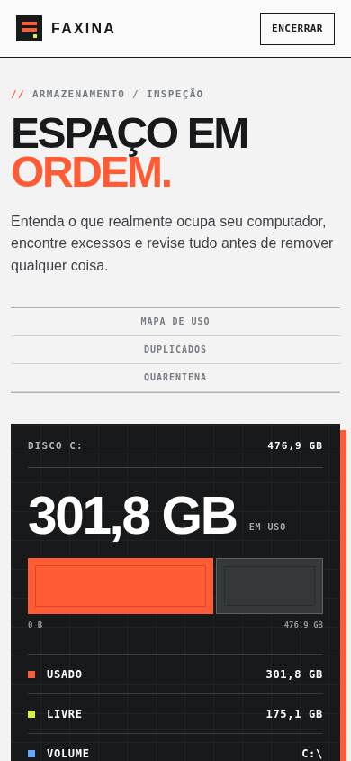
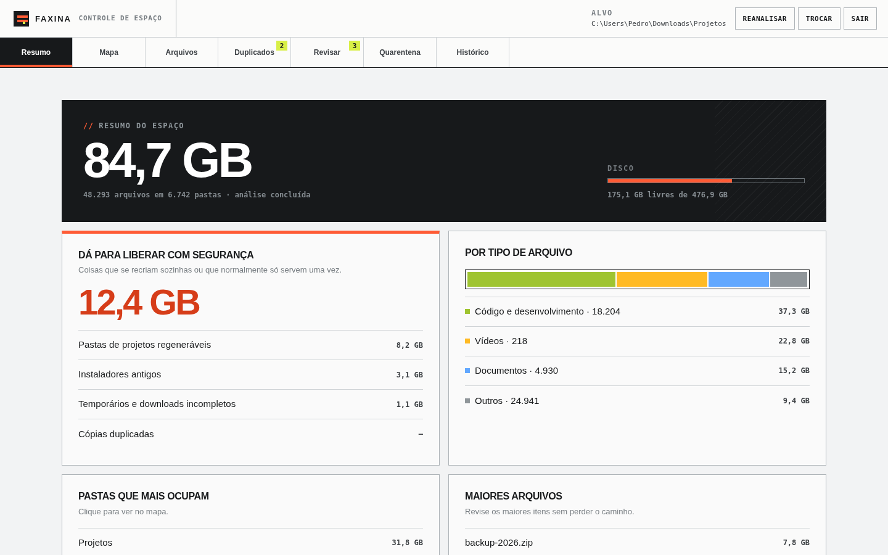
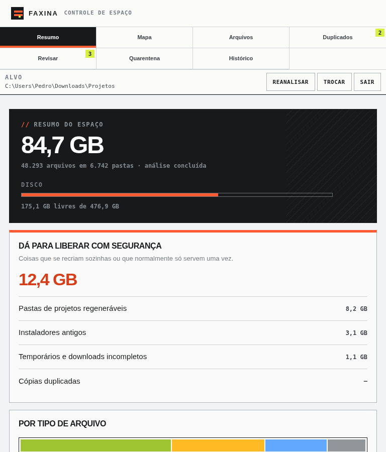
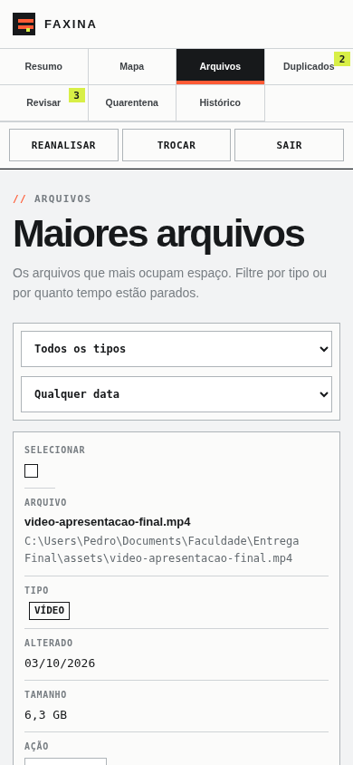
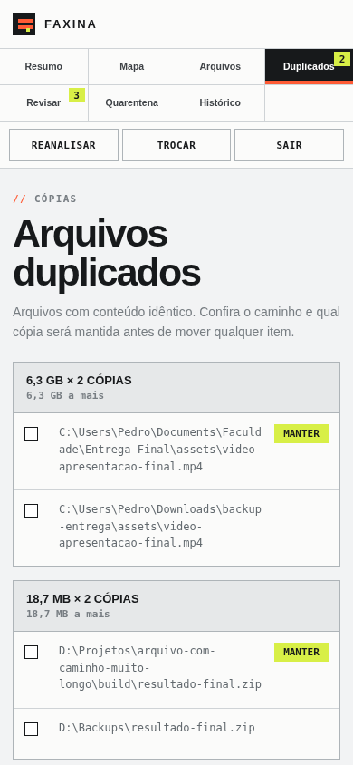

# Faxina

**Descubra para onde foi o espaço do seu computador e libere com segurança.**

O Faxina analisa uma pasta ou um disco inteiro e mostra o que ocupa espaço: um mapa navegável das pastas, os maiores arquivos, cópias duplicadas, instaladores esquecidos e as pastas `node_modules`, `.venv` e `target` de projetos que você nem abre mais. Nada é apagado direto: tudo passa por uma quarentena que dá para desfazer.

Roda 100% no seu computador. Nenhum arquivo, nome ou caminho sai da sua máquina.


## Interface

A interface foi pensada como uma ferramenta de desktop, mas muda de estrutura conforme a largura da janela em vez de apenas encolher. No desktop, controles e navegação ficam em faixas separadas; em tablets, os painéis passam para uma coluna; no celular, a navegação vira uma grade e as tabelas se transformam em cartões legíveis, sem rolagem horizontal.

> As capturas abaixo usam dados de demonstração apenas para documentar a interface. Quando o programa está rodando, total, usado e livre da tela inicial vêm dos volumes reais informados pelo sistema operacional.

### Tela inicial



No celular, a composição é reorganizada e nenhum painel é comprimido lateralmente:



### Depois da análise

A visão geral mantém o resumo do disco e os blocos de decisão em uma hierarquia simples:



Em telas intermediárias, os cards passam para uma coluna e os controles continuam acessíveis:



### Arquivos e duplicados no celular

As tabelas deixam de exigir rolagem lateral: cada linha vira um cartão com rótulos próprios, e caminhos longos usam toda a largura disponível.



Na revisão de duplicados, o caminho continua legível e a indicação **MANTER** permanece sempre visível:




## Como rodar

Precisa só do **Python 3.8 ou mais novo**. Não tem nada para instalar com `pip`: o Faxina usa apenas a biblioteca padrão.

| Sistema | Como abrir |
| --- | --- |
| Windows | Dois cliques em `iniciar.bat` |
| Mac e Linux | `./iniciar.sh` |
| Qualquer um | `python faxina.py` |

O navegador abre sozinho com uma interface adaptada para desktop, tablet e celular, focada em leitura rápida do armazenamento e revisão segura. Para encerrar, use o botão **Encerrar** no app ou feche a janela do terminal.

Opções úteis:

```
python faxina.py --scan "C:\Users\voce\Downloads"   # já abre analisando esta pasta
python faxina.py --port 9000                         # outra porta
python faxina.py --no-browser                        # não abre o navegador
```

### Gerar um `.exe` (Windows)

Dê dois cliques em `gerar-exe.bat`. Ele instala o PyInstaller e cria `dist\Faxina.exe`, um executável único que roda em qualquer Windows, mesmo sem Python instalado.

## O que ele faz

- **Visão geral:** tamanho total, quanto dá para liberar com segurança, divisão por tipo de arquivo e as pastas que mais cresceram desde a última análise.
- **Mapa:** um treemap em que cada bloco é proporcional ao espaço que ocupa. Clique numa pasta para entrar nela; `Esc` volta.
- **Maiores arquivos:** filtráveis por tipo e por tempo sem alteração ("parados há mais de 1 ano").
- **Duplicados:** arquivos com conteúdo idêntico, mesmo com nomes diferentes. Você escolhe qual cópia manter (a mais antiga, a mais recente ou a de caminho mais curto) e o Faxina marca as outras.
- **Limpeza sugerida:** pastas de projetos que se recriam com um comando, instaladores antigos, downloads incompletos e arquivos grandes parados há mais de um ano.
- **Quarentena:** tudo o que você remove vai para cá. Dá para restaurar item por item ou esvaziar de vez.
- **Histórico:** cada análise fica registrada, para você ver se a pasta está crescendo e onde.


## Como funciona por dentro

### Varredura que aguenta milhões de arquivos

A varredura usa `os.scandir`, que já traz o tipo de cada entrada sem uma chamada extra ao sistema, numa pilha em vez de recursão (sem estouro de pilha em pastas muito fundas). Os dados ficam em **arrays compactos do módulo `array`** em vez de um objeto Python por arquivo. Medido com `tracemalloc` em 300 mil arquivos, sem contar os nomes: 72 bytes por arquivo, contra 177 bytes de uma `dataclass` com os mesmos campos (2,4 vezes menos memória).

Os tamanhos das pastas são somados de baixo para cima numa única passada. Como cada pasta é criada depois da pasta-mãe, percorrer os índices em ordem decrescente garante que os filhos sempre são somados antes do pai.

Links simbólicos e *junctions* do Windows não são seguidos, para não contar a mesma coisa duas vezes nem entrar em loop.

### Duplicados em funil

Ler e comparar o disco inteiro seria lento demais, então a busca filtra em quatro etapas, da mais barata para a mais cara:

1. **Tamanho.** Arquivos de tamanhos diferentes nunca são iguais. Essa etapa não lê nada do disco.
2. **Hard links.** Dois nomes que apontam para o mesmo arquivo físico (mesmo dispositivo e inode) não ocupam espaço duas vezes, então não contam como duplicados.
3. **Começo e fim.** Um hash BLAKE2 dos primeiros e dos últimos 64 KB de cada candidato.
4. **Conteúdo inteiro.** Só quem empatou até aqui é lido por completo.

A tela de resultados mostra quanto foi lido de verdade comparado com o total de candidatos. Arquivos dentro de `node_modules`, `.venv` e afins ficam de fora: apagar uma "cópia" lá dentro só quebraria o projeto.

### Lixo de desenvolvimento com marcador

Uma pasta chamada `target` só é tratada como build do Maven ou do Cargo se o projeto tiver `pom.xml` ou `Cargo.toml` ao lado. Uma `.venv` precisa ter `pyvenv.cfg`. Assim, uma pasta qualquer com nome parecido nunca é sugerida por engano. A coluna "último uso do projeto" ignora a própria pasta de dependências, então um `npm install` recente não esconde um projeto abandonado.

### Quarentena no mesmo disco

Mover 50 GB de um HD externo para o disco do sistema levaria minutos e poderia lotar o C:. Por isso cada item vai para uma quarentena **no mesmo disco de onde veio** (uma pasta oculta `.faxina-quarentena` na raiz daquele disco). Mover vira só uma renomeação, instantânea. Itens do disco do sistema ficam na pasta de dados do app.

Ao restaurar, se já existir outro arquivo com o mesmo nome no lugar, o Faxina restaura como `nome (restaurado).ext` em vez de sobrescrever.

### Segurança

- **Pastas do sistema são intocáveis.** O Faxina analisa, mas se recusa a mover qualquer coisa de `C:\Windows`, `Program Files`, `ProgramData`, `/usr`, `/etc` e afins, além de arquivos como `pagefile.sys` e `hiberfil.sys`.
- **Só mexe dentro da pasta analisada.** O servidor confere cada caminho; o navegador nunca diz o que apagar por caminho, só pelo índice de um item que a própria varredura encontrou.
- **Servidor só local.** Escuta apenas em `127.0.0.1`, exige um token sorteado a cada execução em toda chamada da API e confere o cabeçalho `Host`. Assim, um site aberto em outra aba não consegue comandar o Faxina (nem por CSRF, nem por *DNS rebinding*).
- **Interface sem `innerHTML`.** Nomes de arquivo vêm do disco e podem conter qualquer caractere; a interface monta os elementos com `textContent`.

## Estrutura

```
faxina.py               ponto de entrada (python faxina.py)
iniciar.bat / .sh       atalhos para Windows, Mac e Linux
gerar-exe.bat           gera o Faxina.exe com o PyInstaller
faxina/
  scanner.py            varredura e consultas (arrays compactos)
  duplicates.py         busca de duplicados em funil
  categories.py         tipos de arquivo e pastas regeneráveis
  storage.py            SQLite: quarentena e histórico
  state.py              regras do app (o que a API pode fazer)
  server.py             servidor HTTP local com token
  config.py             caminhos e pastas protegidas
  web/                  interface (HTML, CSS e JavaScript puros)
tests/                  testes automatizados
```

## Testes

```
python -m unittest discover -s tests -t .
```

São 19 testes cobrindo o tamanho total contra o disco, as regras de limpeza, o funil de duplicados (incluindo hard links e arquivos com o mesmo começo e fim diferente), quarentena com restauração sem sobrescrever, a escolha do disco da quarentena, o histórico e a segurança do servidor (token, `Host` e acesso a arquivos fora da pasta da interface).

## Onde ficam os dados

O banco (histórico e registro da quarentena) e a quarentena do disco do sistema ficam em:

- Windows: `%LOCALAPPDATA%\Faxina`
- Mac: `~/Library/Application Support/Faxina`
- Linux: `~/.local/share/faxina`

Para usar outra pasta, defina a variável de ambiente `FAXINA_DATA`.
